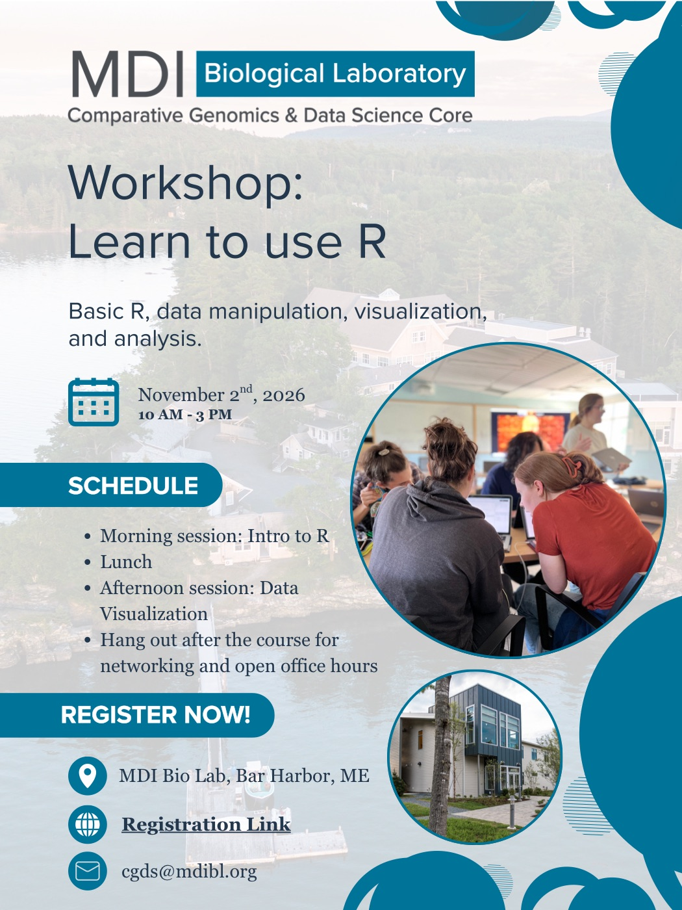

# Workshop: Learn to Use R

This workshop is open to all members of INBRE network institutions. No experience in R is necessary. Continue reading to learn more. 

<!-- more -->

No experience required! Just create a free [GitHub](https://github.com/signup) account ahead of the course. 

[Register here](https://labcentral.mdibl.org/programs/view/764)

More details: 

[{ .center .off-glb style="width:100%; max-width:500px;" }](img/R_course_ad_linked.pdf)

[:material-file-pdf-box: Download the poster (PDF)](img/R_course_ad_linked.pdf){ .md-button }

