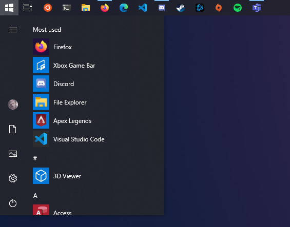
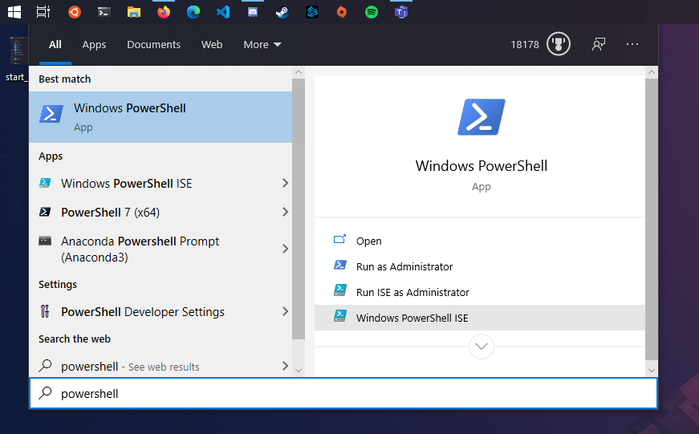
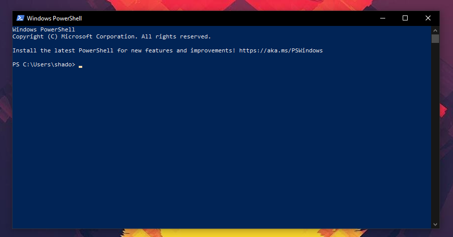

# Getting to the Command-line on Windows with PowerShell

From the Start Menu, search PowerShell. 

<!-- more -->

{: .center style="width:100%; max-width:500px;" }

{: .center  style="width:100%; max-width:600px;"  }

Once you launch the PowerShell app, you should see a window similar to the one below.

{: .center  style="width:100%; max-width:600px;"  }

This will put you in a position to start to test the command-line- I’d recommend that you go to some of our basic tutorials ([link here](learning_command_line.md)) once you have the terminal program running and try it out.

You can always ask your Core personnel for help, too!