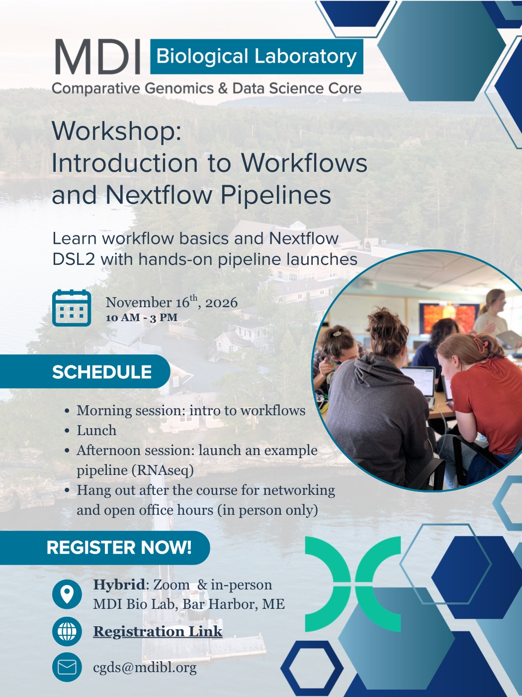

# Workshop: Introduction to Workflows and Nextflow Pipelines, Nov. 16, 2026

This workshop is open to all members of INBRE network institutions. Join us in person at MDI Bio Lab or on Zoom. Continue reading to learn more.

<!-- more -->

The course covers the basic principles of computational workflows, introduces Nextflow's DSL2 workflow language, and gives participants hands-on experience launching their own pipelines to analyze real data.

[Register here](https://labcentral.mdibl.org/programs/view/781)

More details: 

[{ .center .off-glb style="width:100%; max-width:500px;" }](img/Nextflow_course_ad.pdf)

[:material-file-pdf-box: Download the poster (PDF)](img/Nextflow_course_ad.pdf){ .md-button }

