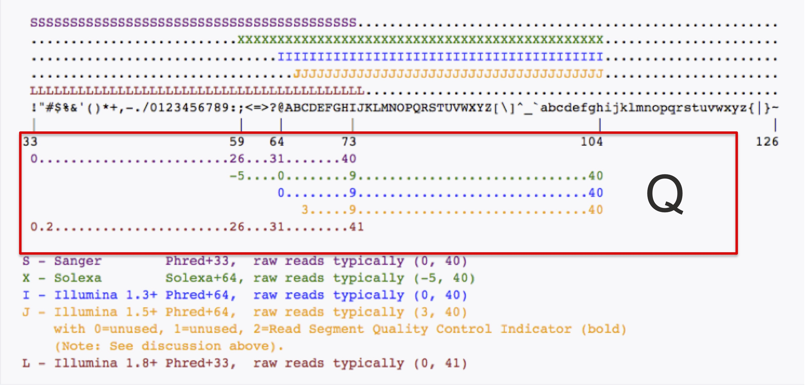
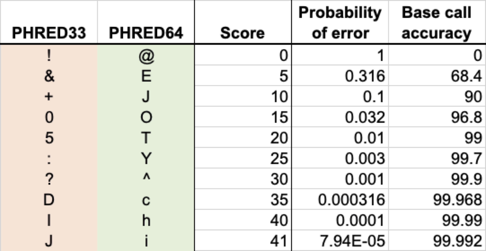

# Understanding sequence files: fasta and fastq

There are two primary file formats for sequence data that are generally used in computational biology/bionformatics.

<!-- more -->

## FASTA: one header line, one or more sequences lines for each entry

The first, **fasta (or FASTA)** is a raw-text format that can hold one or more sequences.  Each sequence will be of the form:

```
>header line
sequence data
```

The header line is a description (including identifier and potentially other metadata) and will always begin with a “>” in the first column.  All subsequent lines are considered part of the sequence until either the end of the line or another header line (for the next sequence is encountered.


Fasta sequence filenames generally end in either of the suffixes “.fa” or “.fasta” but other conventions are occasionally encountered. For example, “.faa” and “.fna” are used for fasts-protein and fasta nucleic acids by some sequence providers.


Many programs will work with fasta files, however, these programs will often put constraints on the nature of the header line.  One common example is that many programs will use only the beginning of the header line (ending at the first “whitespace character”) as an ID for the sequence- this necessitates that all such fragments must be unique across a sequence file- many publicly available datasets will not follow this convention, necessitating preprocessing the file before it can be used in such programs.

## FASTQ: four lines per entry-> header/ID, sequence, “+ line”, quality scores

**FASTQ (or fastq)** files are the standard means of storing and working with modern sequence data. The Q in the file stands for “Quality”, which is an assessment of the likelihood of error for each base in each sequence. (FASTQ was used as an extension/adaptation of the standard “fasta” file format, which is the standard if there are no quality scores to be included.) Each entry in a FASTQ file consists of four lines, with the following format:

```
@unique_sequence_ID 
ATTCATTAAAGCAGTTTATTGGCTTAATGTACATCAGTGAAATCATAAATGCTAAAAATTTATGATAAAA
+
=-(DD--DDD/DD5:*1B3&)-B6+8@+1(DDB:DD07/DB&3((+:?=8*D+DDD+B)*)B.8CDBDD4
```

### Features

1. The header line, starts with ‘@’,followed directly by an ID and an optional description
2. The sequence line, consisting of A, C, G, T (and sometimes N or other ambiguous characters).
3. A line consisting of only a “+” symbol
4. The quality line, which will match the sequence length exactly, and for which there is a one-to-one correspondence by character position. In other words, the quality of the first A is “=”, the quality of the T in position 2 is -, and so on.

### Note

FASTQ files are typically very large (gigabytes or larger, with tens to hundreds of million sequence entries), and as such are frequently compressed. The most common compression is with the program “gzip”, and a file that has been compressed in this manner will typically be named in the manner “my_sequences.fastq.gz” with the gz final extension standing for “gzipped.” Fortunately, many of the programs we use to work with FASTQ files can use the gzipped version.

### What Do the Quality Scores Mean?

The quality score is a character-based representation of the base10 logarithm of the probability that the sequence base is incorrect (as determined by the sequencing machine process). Specifically, if p is the probability of error, then the quality Q is given by

$$Q = -10 \log_{10}(p)$$

For example, if the probability of error is estimated at 1 in 1000, p = 0.001, or Q = 30. Q scores range between 0 (p = 1, a completely unreliable base call) and 40 (p = 0.0001). To reduce these numbers to a one-base code, the numbers 0 through 40 have been mapped onto the ASCII table representation. Several different representations have been generated for this, as shown below:

{ style="width:100%; max-width:900px;" }

Most modern sequence uses the Sanger/Illumina 1.8+ coding. Here are a few examples:

{ style="width:100%; max-width:900px;" }


