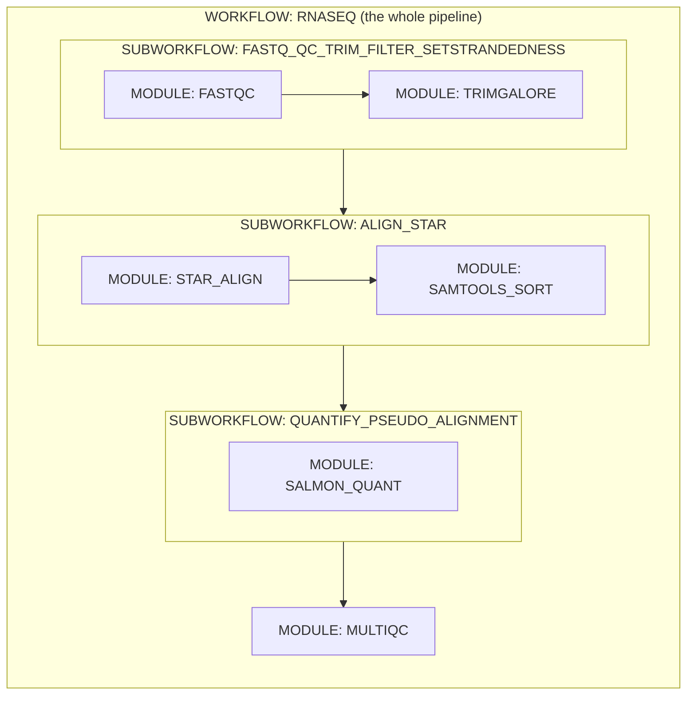

# Computational Workflows

> **Workshop:** ~2 hours hands-on &nbsp;·&nbsp; This page stays open for independent study and office-hours follow-up.

---

!!! info "Learning Objectives"
    By the end of this workshop you will be able to:

    - Describe what a FASTQ file is and what a bioinformatics pipeline does with it
    - Write the three files every pipeline run needs: a **sample sheet**, a **parameters file**, and a **config file**
    - Explain "dependency hell" and how **containers** solve it
    - Describe how a Nextflow pipeline is built from **modules**, **subworkflows**, and a **workflow**
    - Read a pipeline error message, find the problem, and fix it
    - Run the nf-core/rnaseq pipeline from start to finish
    - Find your way around the `work/` directory and the `results/` directory
    - Read a MultiQC report to check the quality of a sequencing experiment

Bioinformatics analyses are rarely a single program. They are **pipelines**: chains of tools that each take a file, change it, and hand it to the next tool, from raw sequencing reads all the way to a table of gene counts. Running those tools one by one by hand is slow, easy to get wrong, and hard to repeat. **Workflow managers** like [Nextflow](https://www.nextflow.io/) run the whole chain for you, the same way every time, on a laptop, a cluster, or the cloud.

In this workshop you will run [nf-core/rnaseq](https://nf-co.re/rnaseq), a community-built, peer-reviewed RNA-seq pipeline, on a small real dataset. **You do not need to know how to program.** Running a pipeline is mostly about preparing a few small text files correctly and knowing where to look when something goes wrong.

## Prerequisites

- No programming experience required
- Recommended: [Managing Data & Projects for Genomics](../genomics/index.md), for file naming and project organization
- Helpful: the blog posts on [learning the command line](../blog/posts/learning_command_line.md) and opening a terminal on [Mac](../blog/posts/navigating_to_terminal_MAC.md) or [Windows](../blog/posts/navigating_to_terminal_WIN.md)

---

## Launch Your Workspace

--8<-- "codespaces-account.md"

This workshop runs entirely in a cloud environment: no software installation required. One click opens a pre-configured computer with Nextflow, Docker, the workshop data, and the pipeline already set up.

<div style="margin: 1.2rem 0;">
<a href="https://codespaces.new/mdibl/mdibl.github.io?devcontainer_path=.devcontainer%2Fworkflows%2Fdevcontainer.json" target="_blank">
  
</a>
</div>

!!! warning "This workshop uses a 4-core machine"
    Pipelines need more memory than our R workshops, so this Codespace runs on a **4-core / 16 GB** machine. If GitHub asks you to choose a machine type, pick **4-core**. A 4-core machine uses your free quota twice as fast as a 2-core one: about **30 hours** of run time per month instead of 60. That is still plenty for this workshop, but remember to stop the Codespace when you are done.

!!! info "First launch takes several minutes"
    The first time the Codespace builds, GitHub installs Nextflow, downloads the workshop FASTQ files, and downloads the pipeline code. You can watch progress in the terminal. When you see `Setup complete.`, you are ready. Subsequent launches are instant.

**What you'll see:**

1. GitHub opens **VS Code** in your browser. This is your workspace for the whole session.
2. On the left is the **Explorer**, a list of files and folders, like Finder or File Explorer. Click a file to open it in the editor.
3. At the bottom is the **Terminal**, where you type commands. If you do not see it, go to **Terminal → New Terminal**.

--8<-- "codespaces-keepalive.md"

!!! tip "How to run a command"
    Every grey box with a :material-content-copy: copy button in the top right is a command. Click the copy button, click into the terminal, paste (++ctrl+v++ on Windows / ++cmd+v++ on Mac, or right-click → Paste), and press ++enter++.

    Lines starting with `#` are comments: notes for you that the computer ignores.

---

## Part 1: Start with the Data: FASTQ Files

Every sequencing experiment starts with **FASTQ files**. A sequencer reads millions of short pieces of DNA (or RNA converted to DNA) and writes each one down as a **read**.

Our dataset is RNA-seq from baker's yeast (*Saccharomyces cerevisiae*), from [GEO accession GSE110004](https://www.ncbi.nlm.nih.gov/geo/query/acc.cgi?acc=GSE110004). The files have been shrunk down to 50,000 reads each so the pipeline finishes in minutes instead of hours.

???+ question "Exercise 1.1: Find your FASTQ files"
    List the files in the `data/fastq` folder:

    ```bash
    ls -lh data/fastq
    ```

    - How many files are there?
    - Why do the names come in pairs ending in `_1` and `_2`?

??? success "Answer"
    There are 14 files: 7 sequencing runs × 2 files each.

    This is **paired-end** sequencing: the sequencer reads each DNA fragment from *both ends*. `_1` holds the first read from each fragment and `_2` holds the matching read from the other end. The two files always travel together.

### What is inside a FASTQ file?

The files end in `.gz`, which means they are compressed (zipped). `zcat` unzips a file on the fly and `head` shows only its first few lines:

```bash
zcat data/fastq/SRR6357070_1.fastq.gz | head -8
```

Every read takes up exactly **4 lines**:

```text
@SRR6357070.25017281 25017281/1 kraken:taxid|4932
CCTGAATCGAGAAGGAGGTGTCCAGGGAGTTCATCATCAGAATGATTAGTATGATTTACTGTAGATTCAGTAAGTTTCTGGCCTAAGATGAAGGTCGTGCT
+
BBBBBFFFFFFFBFFFFFFFFFFFFFFFFFFFFFFFFFFFFBFFFBFFFFFFFFFFFFFFFFFFFFFFFFFFFFFFFFFFFFFFFFFFFFBFFBFFFFFFF
```

| Line | Contents |
|---|---|
| 1 | The read's name. Always starts with `@`. |
| 2 | The DNA sequence |
| 3 | A separator, `+` |
| 4 | The quality: one character for each base in line 2 |

The fourth line is a **quality score** for each base: how confident the sequencer was. Each character stands for a number, and letters near the end of the alphabet mean higher confidence. One of the first things our pipeline does is summarize these scores for every file.

???+ question "Exercise 1.2: How many reads are in a file?"
    Because every read is exactly 4 lines, the number of lines divided by 4 is the number of reads:

    ```bash
    echo $(( $(zcat data/fastq/SRR6357070_1.fastq.gz | wc -l) / 4 ))
    ```

    A real experiment usually has 20 to 50 million reads **per sample**. How many does this test file have?

### Which file belongs to which sample?

File names like `SRR6357070` come from the sequencing archive and tell you nothing about the biology. Sequencing facilities usually send a **sample key** that links each file to a sample. Ours is in `sample_key.csv`:

```bash
cat sample_key.csv
```

| run | sample | condition | replicate |
|---|---|---|---|
| SRR6357070 | WT_REP1 | wild type | 1 |
| SRR6357071 | WT_REP1 | wild type | 1 |
| SRR6357072 | WT_REP2 | wild type | 2 |
| SRR6357073 | RAP1_UNINDUCED_REP1 | RAP1 uninduced | 1 |
| SRR6357074 | RAP1_UNINDUCED_REP2 | RAP1 uninduced | 2 |
| SRR6357075 | RAP1_UNINDUCED_REP2 | RAP1 uninduced | 2 |
| SRR6357076 | RAP1_IAA_30M_REP1 | RAP1 auxin 30 min | 1 |

Notice that **`WT_REP1` and `RAP1_UNINDUCED_REP2` each have two runs**. This happens when the same sample is sequenced twice, for example on two lanes of the sequencer. Those reads belong together, and the pipeline will combine them for us.

---

## Part 2: The Three Files Every Run Needs

A pipeline needs answers to three questions before it can start:

| Question | File | Changes when... |
|---|---|---|
| **Which data?** | Sample sheet (`samplesheet.csv`) | you have new samples |
| **What analysis?** | Parameters file (`params.yaml`) | you change analysis options or the genome |
| **On what computer?** | Config file (`codespaces.config`) | you move to a different computer or cluster |

Keeping these separate is what makes a pipeline reusable: you can run the same analysis on new data by changing only the sample sheet, or move to a bigger computer by changing only the config file.

!!! tip "Creating a new file in VS Code"
    In the Explorer, right-click on the `workflows` folder (the top level) → **New File...**, type the file name, and press ++enter++. The file opens in the editor. Save with ++ctrl+s++ / ++cmd+s++.

### 2.1 The sample sheet

The sample sheet is a spreadsheet saved as a **CSV** (comma-separated values) file. Each row is one pair of FASTQ files. nf-core/rnaseq expects exactly these four columns:

| Column | What it means |
|---|---|
| `sample` | The sample name. **No spaces.** Rows with the same name are merged into one sample. |
| `fastq_1` | Path to the read 1 file |
| `fastq_2` | Path to the read 2 file (leave empty for single-end data) |
| `strandedness` | How the library was prepared: `forward`, `reverse`, `unstranded`, or `auto` (let the pipeline figure it out) |

We have started it for you in `samplesheet_template.csv`. Make your own copy:

```bash
cp samplesheet_template.csv samplesheet.csv
```

???+ question "Exercise 2.1: Finish the sample sheet"
    Open `samplesheet.csv` in the editor. It has the header row and the first sample. Using `sample_key.csv`, add one row for each of the other six runs. Use `auto` for strandedness. Save the file when you are done.

    !!! tip "You can open a CSV in Excel too"
        For real projects, many people build their sample sheet in Excel or Google Sheets and **Save As → CSV**. Just be sure to save as plain CSV, not `.xlsx`.

??? success "Solution"
    ```text
    sample,fastq_1,fastq_2,strandedness
    WT_REP1,data/fastq/SRR6357070_1.fastq.gz,data/fastq/SRR6357070_2.fastq.gz,auto
    WT_REP1,data/fastq/SRR6357071_1.fastq.gz,data/fastq/SRR6357071_2.fastq.gz,auto
    WT_REP2,data/fastq/SRR6357072_1.fastq.gz,data/fastq/SRR6357072_2.fastq.gz,auto
    RAP1_UNINDUCED_REP1,data/fastq/SRR6357073_1.fastq.gz,data/fastq/SRR6357073_2.fastq.gz,auto
    RAP1_UNINDUCED_REP2,data/fastq/SRR6357074_1.fastq.gz,data/fastq/SRR6357074_2.fastq.gz,auto
    RAP1_UNINDUCED_REP2,data/fastq/SRR6357075_1.fastq.gz,data/fastq/SRR6357075_2.fastq.gz,auto
    RAP1_IAA_30M_REP1,data/fastq/SRR6357076_1.fastq.gz,data/fastq/SRR6357076_2.fastq.gz,auto
    ```

    If you get stuck, copy the finished version: `cp solutions/samplesheet.csv samplesheet.csv`

### 2.2 The parameters file

**Parameters** are the choices about your analysis: where the input is, where results should go, which tools to use. Every nf-core pipeline lists its parameters on its website. Here is [the full list for nf-core/rnaseq](https://nf-co.re/rnaseq/parameters).

Create a new file called `params.yaml` and paste in:

```yaml
# params.yaml
# Settings about YOUR ANALYSIS: what goes in, where results go,
# and which options to use.

input:  'samplesheet.csv'   # the sample sheet you wrote
outdir: 'results'           # where finished results are saved

aligner: 'star_salmon'      # align reads with STAR, count them with Salmon
skip_bbsplit: true          # skip a contamination-screening step we do not need today
```

This is a **YAML** file: each line is a `name: value` pair. Spacing matters, so keep each setting at the start of its line.

!!! note "Where is the genome?"
    For a real experiment you would also add the reference genome here, for example `fasta:` and `gtf:` (the genome sequence and the gene annotation). Today we borrow a tiny yeast reference from the pipeline's built-in **test profile**, which is why you will see `-profile test` in our commands.

### 2.3 The config file

The **config file** describes the computer, not the analysis. Our Codespace has 4 CPUs and 16 GB of memory, so we tell Nextflow never to give any one step more than that. Create a new file called `codespaces.config` and paste in:

```groovy
// codespaces.config
// Settings about the COMPUTER the pipeline runs on (not about your data).

process {
    resourceLimits = [
        cpus:   4,
        memory: '12.GB',
        time:   '2.h'
    ]
}
```

On an HPC cluster or in the cloud, this is the file where you would say "send jobs to the SLURM scheduler" or "run on AWS". The sample sheet and parameters file would not change at all.

??? success "Check your work"
    You should now have three new files next to `samplesheet_template.csv`:

    ```bash
    ls samplesheet.csv params.yaml codespaces.config
    ```

    Finished copies are in the `solutions/` folder if you need them: `cp solutions/* .`

---

## Part 3: Dependency Hell, and How Containers Fix It

Our pipeline uses more than 20 different programs: FastQC, Trim Galore, STAR, Salmon, SAMtools, Picard, MultiQC, and more. Each one has to be installed, and each one depends on other software being installed in just the right versions.

???+ question "Exercise 3.1: Try to run a tool"
    SAMtools is one of the most common tools in genomics. Try to check its version:

    ```bash
    samtools --version
    ```

??? success "What happened?"
    ```text
    bash: samtools: command not found
    ```

    It is not installed. You could install it, and then do the same for 20 more tools. That is where the trouble starts.

### Dependency hell

Imagine you need two tools:

- **Tool A** was written years ago and only works with **SAMtools 1.9**
- **Tool B** is brand new and needs **SAMtools 1.21**

A computer normally has only one `samtools`. Install one version and you break the other tool. Multiply this across dozens of tools, each with its own requirements, and you get **dependency hell**: hours spent installing and uninstalling software, and an analysis that works on your laptop but nowhere else. Even worse, if a colleague runs "the same" analysis with different tool versions, they may get slightly different results.

### Containers

A **container** is a sealed box that holds one tool **plus everything it needs to run**, frozen at a specific version. You do not install the tool; you just run the box. Each box is isolated, so different versions never conflict.

Our Codespace has **Docker**, a program that runs containers. Run SAMtools 1.9 from a container:

```bash
docker run --rm quay.io/biocontainers/samtools:1.9--h91753b0_8 samtools --version | head -1
```

Now run SAMtools 1.21 from a different container, on the same computer:

```bash
docker run --rm quay.io/biocontainers/samtools:1.21--h50ea8bc_0 samtools --version | head -1
```

!!! info "The first run of each command is slow"
    Docker downloads the container the first time you use it. After that it is stored on the computer and starts instantly.

Two versions of the same tool, side by side, with nothing installed and no conflicts. Breaking down the command:

| Piece | Meaning |
|---|---|
| `docker run` | Start a container |
| `--rm` | Throw the container away when it finishes |
| `quay.io/biocontainers/samtools` | Which container: SAMtools, from the [BioContainers](https://biocontainers.pro/) library |
| `:1.9--h91753b0_8` | The exact version (the **tag**). This never changes, so results are reproducible. |
| `samtools --version` | The command to run inside the container |

**You will not have to type `docker run` again.** Every step of an nf-core pipeline already names its exact container. When you add `-profile docker` to a pipeline command, Nextflow fetches and runs the right container for every step automatically.

???+ question "Exercise 3.2: Check what's on your computer"
    List the containers Docker has downloaded so far:

    ```bash
    docker images
    ```

    Run this again after the pipeline finishes. How many containers did the pipeline download for you?

---

## Part 4: How a Nextflow Pipeline Is Built

A Nextflow pipeline is built like a set of nesting boxes:



| Level | What it is | Kitchen analogy |
|---|---|---|
| **Module** | One tool doing one job, e.g. FastQC checking read quality. Each module has its own container. | One step in a recipe: "chop the onions" |
| **Subworkflow** | A few modules that are always used together, e.g. QC then trim | A recipe: "make the sauce" |
| **Workflow** | All the subworkflows and modules wired together, from FASTQ to results | The whole meal |

Modules are shared. The same FASTQC module is used by dozens of nf-core pipelines, so when one person improves it, every pipeline benefits. Our diagram shows only a few of the steps; the real pipeline has many more.

???+ question "Exercise 4.1: Look inside the pipeline"
    The Codespace already downloaded the pipeline code. Look at its top-level folders:

    ```bash
    ls ~/.nextflow/assets/nf-core/rnaseq
    ```

    Now list the modules and subworkflows:

    ```bash
    ls ~/.nextflow/assets/nf-core/rnaseq/modules/nf-core
    ls ~/.nextflow/assets/nf-core/rnaseq/subworkflows/nf-core
    ```

    Can you spot modules for tools mentioned in Part 3 (`fastqc`, `samtools`, `salmon`, `star`, `multiqc`)?

You will see each module's name again when the pipeline runs: Nextflow prints one line per module as it works.

---

## Part 5: Learning to Read Errors

Things will go wrong when you run pipelines on your own data. That is normal. The skill that matters most is **reading the error message**: it almost always tells you exactly what is wrong.

The `errors/` folder holds broken sample sheets. Each one has one mistake that is easy to make by hand. Run the pipeline with each one, read the error, and find the mistake.

The command to run the pipeline looks like this. We will go through each piece in Part 6.

???+ question "Exercise 5.1: A broken sample sheet"
    ```bash
    nextflow run nf-core/rnaseq -r 3.27.0 \
        -profile test,docker \
        -params-file params.yaml \
        -c codespaces.config \
        --input errors/samplesheet_error1.csv
    ```

    Nextflow checks the sample sheet *before* doing any work, so this fails in seconds. Read the red text. Which row and which column is the problem? Open `errors/samplesheet_error1.csv` and compare it to your own sample sheet.

    !!! note "`--input` on the command line overrides `params.yaml`"
        Anything you type after `--` on the command line replaces the same setting in your parameters file. This is handy for quick tests.

??? success "Answer"
    The error says the sample name **cannot contain spaces**. The `WT_REP2` row says `WT REP2` instead. Spaces in names break many tools, which is why the pipeline refuses them up front. (See our blog post on [naming files](../blog/posts/filenames.md).)

???+ question "Exercise 5.2: Two more broken sample sheets"
    Run the same command with `--input errors/samplesheet_error2.csv`, then with `--input errors/samplesheet_error3.csv`. For each one: what does the error say, and what is the mistake?

??? success "Answers"
    **Error 2:** the error says a FASTQ file **does not exist**. Look closely at the path: `SRR63570O2_1` has a capital letter **O** where there should be a zero. Typos in file paths are the most common mistake of all. Copying and pasting file names, rather than retyping them, helps avoid them.

    **Error 3:** the error says strandedness must be one of `auto`, `forward`, `reverse` or `unstranded`. The last row says `yes`. The pipeline only accepts the exact words it knows.

???+ question "Exercise 5.3: Forgetting the containers"
    This time the sample sheet is correct, but we "forget" to tell Nextflow to use Docker:

    ```bash
    nextflow run nf-core/rnaseq -r 3.27.0 \
        -profile test \
        -params-file params.yaml \
        -c codespaces.config
    ```

    This one gets further before it fails. Read the error. What does `command not found` remind you of?

??? success "Answer"
    Without `-profile docker`, Nextflow tries to run each tool directly on our computer, where none of them are installed. That is exactly what happened in Exercise 3.1. The error shows `Command exit status: 127` (the code for "command not found") and points to a **work directory**, where all the details are kept. We will look inside one in Part 7.

!!! tip "How to read any pipeline error"
    1. **Scroll up** to the first red text. Later errors are often just side effects of the first one.
    2. Look for a **file name, row, or column**. The error usually names exactly what is wrong.
    3. If a step failed, look for `Command error:` and `Work dir:`. Those tell you what the tool itself said, and where to find its files.
    4. Search the [nf-core Slack](https://nf-co.re/join) or the pipeline's GitHub issues for the error text. Someone has usually hit it before.

---

## Part 6: Run the Pipeline

Now run it for real, with your sample sheet and containers turned on:

```bash
nextflow run nf-core/rnaseq -r 3.27.0 \
    -profile test,docker \
    -params-file params.yaml \
    -c codespaces.config \
    -resume
```

| Piece | Meaning |
|---|---|
| `nextflow run nf-core/rnaseq` | Run the rnaseq pipeline from nf-core |
| `-r 3.27.0` | Use exactly version 3.27.0. **Always pin a version** so you can repeat the analysis later. |
| `-profile test,docker` | Use the small test genome, and run every step in its container |
| `-params-file params.yaml` | Your analysis settings (which also point to your sample sheet) |
| `-c codespaces.config` | Your computer settings |
| `-resume` | Reuse any steps that already finished successfully instead of redoing them |

!!! note "One dash or two?"
    Options with **one dash** (`-profile`, `-resume`) are settings for **Nextflow** itself. Options with **two dashes** (`--input`, `--outdir`) are **pipeline parameters**, the same settings you put in `params.yaml`.

This takes **about 15 to 30 minutes** the first time, mostly to download containers. While it runs, watch the screen:

```text
[a1/b2c3d4] NFC…:FASTQ_QC_TRIM_FILTER_SETSTRANDEDNESS:FASTQ_FASTQC_UMITOOLS_TRIMGALORE:FASTQC (WT_REP1)  [100%] 5 of 5 ✔
[e5/f6a7b8] NFC…:FASTQ_QC_TRIM_FILTER_SETSTRANDEDNESS:FASTQ_FASTQC_UMITOOLS_TRIMGALORE:TRIMGALORE (WT_REP2) [ 60%] 3 of 5
```

Each line is one **module**. Read the long name from right to left and you will see the nesting from Part 4: the module (`FASTQC`) inside its subworkflows inside the workflow. The counter shows how many samples have finished that step, and the code at the start (`a1/b2c3d4`) tells you where that step's work directory is.

???+ question "Exercise 6.1: While you wait"
    - How many samples does the `FASTQC` line say it is processing? Is that the number of rows in your sample sheet? Why or why not?
    - Find a line with `STAR_ALIGN`. Which subworkflow is it in?

??? success "Answer"
    `FASTQC` runs once per **sample**, not per row: 5 samples, not 7, because the two `WT_REP1` rows and the two `RAP1_UNINDUCED_REP2` rows were merged first (by a module called `CAT_FASTQ`). `STAR_ALIGN` runs inside the `ALIGN_STAR` subworkflow.

When it finishes you will see a green summary:

```text
-[nf-core/rnaseq] Pipeline completed successfully -
```

!!! tip "What `-resume` saves you"
    If the run stops partway (an error, or the Codespace goes to sleep), fix the problem and run **the exact same command** again. With `-resume`, every step that already finished is skipped (marked `cached`), and the pipeline continues where it left off.

---

## Part 7: Inside the `work/` Directory

Every single task (one module, run on one sample) gets its own private folder inside `work/`. This is where the tool actually ran.

```bash
ls work
```

You will see dozens of folders with two-character names like `a1`. Each one holds folders with long random names. That code is the same one printed at the start of each line in Part 6.

To find the work directory for a particular step, ask Nextflow for a list of every task from the last run:

```bash
nextflow log last -f name,status,workdir | grep FASTQC
```

Copy one of the paths and look inside, including the hidden files (`-a`):

```bash
ls -a <paste-the-path-here>
```

```text
.command.sh      ← the exact command that was run
.command.run     ← the wrapper Nextflow used to run it (sets up the container)
.command.out     ← what the tool printed while it ran
.command.err     ← error messages from the tool
.command.log     ← .command.out and .command.err together
.exitcode        ← 0 means success; anything else means failure
SRR...fastq.gz   ← the input files (links, not copies)
WT_REP1_1_fastqc.html  ← the output files
```

???+ question "Exercise 7.1: What actually ran?"
    Look at the command and the exit code:

    ```bash
    cat <paste-the-path-here>/.command.sh
    cat <paste-the-path-here>/.exitcode
    ```

    Nextflow filled in the file names and settings for you. This is the same command you would have had to type by hand, for every sample, for every tool.

!!! tip "Debugging with the work directory"
    When a step fails, Nextflow prints its `Work dir:`. Go there and read `.command.err` to see the tool's own error, and `.command.sh` to see exactly what was run. You can find the failed run from Exercise 5.3 this way:

    ```bash
    nextflow log
    ```

    Pick the run name with status `ERR`, then run `nextflow log <run-name> -f name,status,workdir | grep FAILED`.

!!! warning "`work/` is scratch space"
    The work directory holds every intermediate file and gets **very large** on real data. Once the run is finished and you have checked your `results/`, you can delete it with `rm -rf work`. You will lose the ability to `-resume` that run, but your results are safe.

---

## Part 8: Results and MultiQC

### The output directory

Finished files are copied from `work/` into the `results/` folder you named in `params.yaml`:

```bash
ls results
```

```text
results/
├── fastqc/              ← read quality, before trimming
├── trimgalore/          ← trimming reports
├── star_salmon/         ← alignment and gene counts
│   ├── salmon.merged.gene_counts.tsv   ← the gene count table
│   ├── salmon.merged.gene_tpm.tsv      ← normalized expression (TPM)
│   ├── WT_REP1/ …                      ← one folder per sample
│   └── …
├── salmon/              ← counts from Salmon run directly on the reads
├── multiqc/
│   └── star_salmon/
│       └── multiqc_report.html         ← START HERE
└── pipeline_info/       ← what ran, when, with which versions
```

Your folder will contain a few more folders than this, one for each quality-control tool.

!!! success "The same structure, every time"
    The folder layout and file names are **identical on every run** of this pipeline version. The count table is always at `star_salmon/salmon.merged.gene_counts.tsv`. Samples are always named with the names from **your sample sheet**, never the original `SRR` numbers.

    This means scripts written for one project work on the next one, collaborators know where to look, and the [nf-core/rnaseq output documentation](https://nf-co.re/rnaseq/3.27.0/docs/output) describes every file you have. It is also why your sample names matter: choose them well in the sample sheet and they follow your data all the way through.

The gene count table is what you take into differential expression analysis. See our [Bulk RNA-seq workshop](../bulkDGE/index.md).

???+ question "Exercise 8.1: Look at your gene counts"
    ```bash
    head -5 results/star_salmon/salmon.merged.gene_counts.tsv
    ```

    How many sample columns are there? Do the column names match your sample sheet?

### Reading the MultiQC report

**MultiQC** collects the quality-control output from every tool and every sample into one web page. It is the first thing to open after any run.

In the Explorer, go to `results/multiqc/star_salmon/`, right-click `multiqc_report.html`, and choose **Download...** Then open the downloaded file in your web browser.

We will go through the report together. Things to look for:

| Section | Question it answers | What you hope to see |
|---|---|---|
| **General Statistics** (table at the top) | How did each sample do overall? | Similar numbers across samples; no sample that stands out |
| **FastQC: Sequence Quality** | Was the sequencing good? | Lines staying in the green zone |
| **FastQC: Adapter Content** | Were sequencing adapters left on the reads? | Low before trimming, near zero after |
| **STAR: Alignment Scores** | What fraction of reads matched the genome? | Most reads "Uniquely mapped" |
| **Salmon: Fragment Length** | Do the libraries look alike? | Similar curves for every sample |
| **Software Versions** (bottom) | Exactly which tools and versions were used? | A record for your methods section |

???+ question "Exercise 8.2: Explore the report"
    - Which sample has the most reads? Which has the fewest?
    - What percentage of reads were uniquely mapped by STAR for `WT_REP1`?
    - Scroll to **Software Versions**. Which version of FastQC was used? Does it match the container tag you would find in the FastQC module?

!!! warning "This is a tiny test dataset"
    Some plots will look odd or show warnings because each file has only 50,000 reads. On real data, the same report would show much smoother curves.

---

## Part 9 (if time): How a Module Works

Let's open the FastQC module and see how one step is built:

```bash
code ~/.nextflow/assets/nf-core/rnaseq/modules/nf-core/fastqc/main.nf
```

You do not need to understand every line. Look for these parts:

```groovy
process FASTQC {
    tag "${meta.id}"                                        // ① label shown on screen: the sample name
    label 'process_low'                                     // ② how much CPU and memory to ask for

    container "... 'quay.io/biocontainers/fastqc:0.12.1--hdfd78af_0' }"  // ③ the exact container

    input:
    tuple val(meta), path(reads, stageAs: '?/*')            // ④ what comes in: sample info + FASTQ files

    output:
    tuple val(meta), path("*.html"), emit: html             // ⑤ what goes out: the reports
    tuple val(meta), path("*.zip"),  emit: zip

    script:
    """
    fastqc \\
        --threads ${task.cpus} \\
        ${renamed_files}                                     // ⑥ the actual command
    """
}
```

1. **tag**: the sample name you saw on screen while the pipeline ran
2. **label**: a size category; the pipeline's config turns `process_low` into a number of CPUs and amount of memory, and your `codespaces.config` caps it
3. **container**: the exact FastQC version, the same kind of tag you used with `docker run` in Part 3
4. **input**: what this step needs: information about the sample, and its FASTQ files
5. **output**: what this step produces and passes on: the `.html` report and the `.zip` data that MultiQC later collects
6. **script**: the command itself, with blanks that Nextflow fills in for each sample. Compare this to the `.command.sh` you looked at in Exercise 7.1.

Every module in every nf-core pipeline follows this same pattern: **inputs → container → command → outputs**. Wire modules together and you have a subworkflow; wire subworkflows together and you have a pipeline.

---

## Running on Your Own Data

To run nf-core/rnaseq on your own experiment, you change only two of the three files:

1. **Sample sheet:** one row per FASTQ pair, with good sample names.
2. **Parameters file:** remove `-profile test` and give the pipeline your organism's reference, either with `genome:` or with `fasta:` and `gtf:`. Check the [usage documentation](https://nf-co.re/rnaseq/usage) for the right options.
3. **Config file:** real data needs a bigger computer than a Codespace. At MDIBL, talk to the CGDS Core about running on our cluster or in the cloud.

## Further Reading

- [nf-core/rnaseq documentation](https://nf-co.re/rnaseq): usage, parameters, and output
- [nf-core pipelines](https://nf-co.re/pipelines): more than 100 community pipelines for other data types
- [Nextflow training](https://training.nextflow.io/): free, self-paced courses, from beginner to advanced
- [MultiQC documentation](https://docs.seqera.io/multiqc): what every section of the report means

!!! danger "Before you leave: stop your Codespace"
    Press ++ctrl+c++ in the keepalive terminal, then go to [github.com/codespaces](https://github.com/codespaces), click `···` next to your Codespace, and select **Stop codespace**. Closing the browser tab is not enough.

---

*Questions? Contact the CGDS Core — [CGDS@mdibl.org](mailto:CGDS@mdibl.org)*
